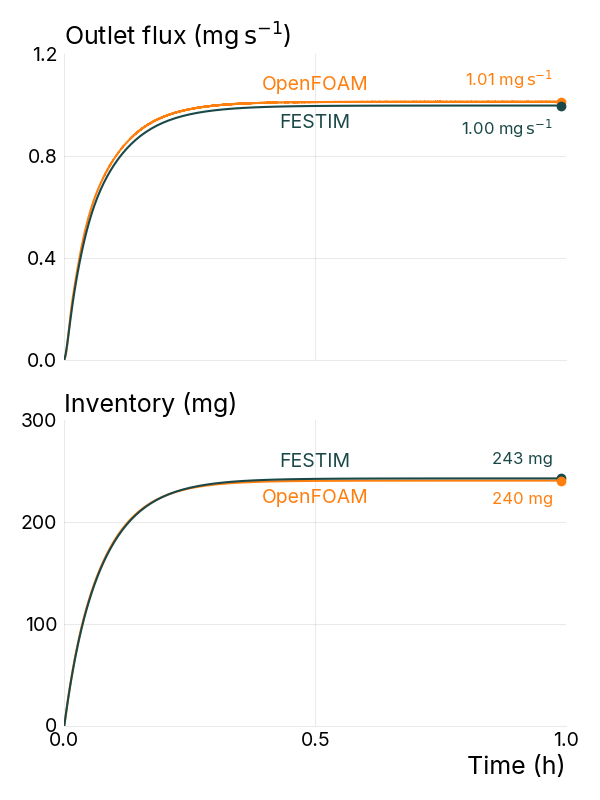
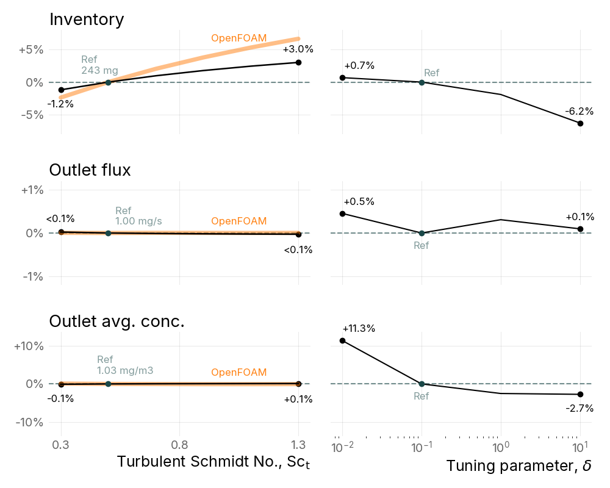

# Multiphysics tritium transport modelling of the ARC breeding blanket with FESTIM

[](https://doi.org/10.5281/zenodo.23717640)
[](https://arxiv.org/abs/2608.05398)
[](LICENSE)

This is the companion repository for the publication:

> J. Dark, A. Sircar, J. W. Bae, J. S. Dokken, R. Delaporte-Mathurin,
> **Multiphysics tritium transport modelling of the ARC breeding blanket with FESTIM**
> arXiv preprint [arXiv:2608.05398](https://arxiv.org/abs/2608.05398) (2026).

It contains the input data, simulation scripts, raw results, and plotting scripts needed to reproduce the FESTIM results and figures in the paper.

## Overview

The paper presents a fully open-source, component-scale multiphysics workflow for tritium transport in the ARC liquid-immersion FLiBe blanket. It couples:

- **OpenMC** for neutron transport (tritium generation and nuclear heating),
- **OpenFOAM** for thermal hydraulics (velocity, temperature, turbulent viscosity), within the ORNL [FERMI](https://doi.org/10.1080/15361055.2022.2151818) framework,
- **[FESTIM](https://github.com/festim-dev/FESTIM)** for hydrogen isotope transport.

Fields are transferred between solvers with [foam2dolfinx](https://github.com/festim-dev/foam2dolfinx) and [openmc2dolfinx](https://github.com/festim-dev/openmc2dolfinx). The model covers a 5° sector of the blanket, and full-blanket quantities are obtained by scaling by 72.

FESTIM solves the advection–diffusion equation for mobile tritium using an effective diffusivity

$$D_\mathrm{eff} = D_0 \exp\left(-\frac{E_D}{k_B T}\right) + \frac{\nu_t}{\mathrm{Sc}_t} + \delta\, h \lVert \mathbf{u} \rVert,$$

which combines Fickian diffusion, turbulent diffusion, and artificial (stabilisation) diffusion. A zero-concentration condition is applied at the inlet, which models perfect extraction.

### Key results

| Quantity (full blanket, steady state) | FESTIM | OpenFOAM |
|---|---|---|
| Tritium inventory | 243 mg | 240 mg |
| Outlet tritium flux | 1.00 mg s⁻¹ | 1.01 mg s⁻¹ |
| Time for outlet flux to reach 99.5 % of steady state | 25.0 min | 23.1 min |

**Figure 8:** Transient outlet flux and inventory, FESTIM vs. OpenFOAM.

<p align="center">
  
</p>

**Figure 9:** Sensitivity of inventory, outlet flux, and outlet-averaged concentration to the turbulent Schmidt number Sc<sub>t</sub> (left) and the stabilisation parameter δ (right).

<p align="center">
  
</p>

<!-- TODO: add field renders from the paper (e.g. Fig. 6e steady-state tritium concentration) to figures/ and embed them here -->

## Repository structure

```
├── festim_script.py              # Main FESTIM model (steady-state reference case)
├── helpers.py                    # Mesh tagging, stabilisation term, advective flux export
├── data_utils.py                 # Unzips the input data on first use
├── testing_sc.py                 # Turbulent Schmidt number sweep (Sc_t = 0.3 – 1.3)
├── testing_delta.py              # Stabilisation parameter sweep (δ = 0.01 – 10)
├── plot_transient_comparison.py  # Figure 8
├── plot_parametric_results.py    # Figure 9
├── read_and_convert_foam_data.py # Utility: export OpenFOAM fields to VTX for visualisation
├── environment.yml               # Conda environment
├── data/
│   ├── NewOF_symmBCs_mesh.zip      # OpenFOAM case: mesh, system/, constant/
│   ├── NewOF_symmBCs_fields.zip    # OpenFOAM fields at t = 745 s (U, T, nut, tritProd, heatGen)
│   └── OpenFOAM_results_ORNL.zip   # ORNL OpenFOAM passive-scalar results for the comparison
├── results/symmBCs/              # FESTIM outputs (CSV): steady/, transient/, sc_testing/, delta_testing/
├── results/                      # Figure 8
└── figures/                      # Figure 9
```

The input data is stored as zip archives to stay under GitHub's file size limit. The scripts extract them automatically on first use, so you don't need to unzip anything by hand.

## Installation

Install the environment with [conda](https://docs.conda.io/) (or mamba):

```bash
git clone https://github.com/jhdark/Multiphysics-tritium-transport-modelling-of-the-ARC-breeding-blanket-with-FESTIM.git
cd Multiphysics-tritium-transport-modelling-of-the-ARC-breeding-blanket-with-FESTIM
conda env create -f environment.yml
conda activate arc-modelling-env
```

This installs FESTIM 2.0b2 (with DOLFINx), foam2dolfinx, openmc2dolfinx, PyVista, and the plotting dependencies.

## Reproducing the results

Run all commands from the repository root. The FESTIM output CSVs are already included in `results/symmBCs/`, so you can go straight to [Plotting](#plotting) to regenerate the figures without rerunning the simulations.

### 1. Steady-state reference case

```bash
python festim_script.py
```

This runs the reference case (Sc<sub>t</sub> = 0.5, δ = 0.1) and writes to `results/symmBCs/steady/`:

- `total_inventory.csv`
- `outlet_surface_flux.csv`
- `inlet_surface_flux.csv`
- `outlet_average_concentration.csv`
- an XDMF file of the concentration field

It also prints a global mass balance (production vs. inlet and outlet flux).

> **Note:** FESTIM reports quantities for the 5° sector in particles (m⁻³, s⁻¹). To convert to full-blanket mass, multiply by the tritium mass (3.016 u = 5.008 × 10⁻²⁷ kg) and by 72 for extensive quantities. The plotting scripts do this conversion.

### 2. Transient case (Figure 8)

The transient run uses the same script with `steady=False`. Edit the `build_festim_model(...)` call in the `__main__` block of `festim_script.py`:

```python
steady = (False,)
export_foldername = ("results/symmBCs/transient",)
```

Then run `python festim_script.py` again. The simulation runs to 1.5 h with adaptive time stepping.

### 3. Parametric studies (Figure 9)

```bash
python testing_sc.py      # -> results/symmBCs/sc_testing/sc_<value>/
python testing_delta.py   # -> results/symmBCs/delta_testing/delta_<value>/
```

### Plotting

```bash
python plot_transient_comparison.py   # Figure 8 -> results/plot_transient_comparison.{png,pdf}
python plot_parametric_results.py     # Figure 9 -> figures/plot_parametric.{png,pdf}
```

Both scripts also load the ORNL OpenFOAM results (from `data/OpenFOAM_results_ORNL.zip`) for comparison.

## Citation

If you use this repository, please cite the paper and this dataset:

```bibtex
@misc{dark_arc_festim,
  title         = {Multiphysics tritium transport modelling of the ARC breeding blanket with FESTIM},
  author        = {Dark, James and Sircar, Arpan and Bae, Jin Whan and Dokken, J{\o}rgen S. and Delaporte-Mathurin, R{\'e}mi},
  year          = {2026},
  eprint        = {2608.05398},
  archivePrefix = {arXiv},
  url           = {https://arxiv.org/abs/2608.05398}
}

@software{dark_arc_festim_zenodo,
  author    = {Dark, James},
  title     = {Companion repository: Multiphysics tritium transport modelling of the ARC breeding blanket with FESTIM},
  year      = {2026},
  publisher = {Zenodo},
  doi       = {10.5281/zenodo.XXXXXXX}
}
```

## Acknowledgements

This material is based upon work supported by the National Science Foundation under Grant No. 2449339. Some of the authors are funded under Contract DE-FOA0002924 with the US Department of Energy. The OpenMC and OpenFOAM inputs were produced at Oak Ridge National Laboratory within the FERMI framework.

## License

This project is licensed under the [MIT License](LICENSE).
